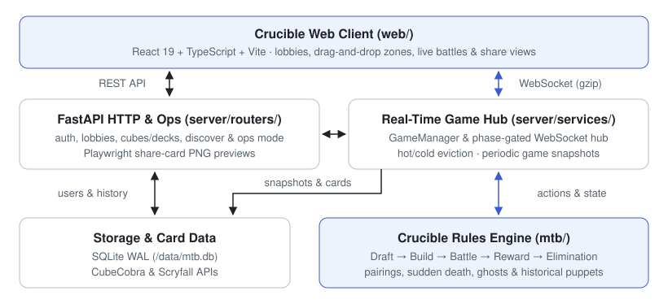

# Crucible

An online multiplayer application for [Crucible](https://cubecobra.com/cube/overview/auto), a Magic: The Gathering autobattler format combining booster drafting with elimination-style battles. Draft from shared cubes or play constructed decks, attach upgrades and vanguards, battle live opponents or historical puppets, and fight to be the last player standing.

Join the [Discord](https://discord.gg/MKMacp9JUf) to find games, report issues, and discuss the format.

<picture>
  <source media="(prefers-color-scheme: dark)" srcset="assets/architecture-dark.svg">
  <source media="(prefers-color-scheme: light)" srcset="assets/architecture-light.svg">
  
</picture>

## Stack

- **Game engine and server**: Python 3.12+, FastAPI, WebSockets (gzip-compressed), SQLite (WAL mode), Playwright (share previews)
- **Web client**: React 19, TypeScript, Vite, Tailwind CSS, `@dnd-kit`
- **Deployment**: Docker on [Fly.io](https://fly.io) with persistent `/data` storage and zero-surprise drain deploys

## Quick start

```sh
# 1. Install backend and frontend dependencies
uv sync --group dev
cd web && npm ci && cd ..

# 2. Run backend (:8000) and Vite frontend (:3000)
uv run dev

# Or build web/dist and serve everything from FastAPI on :8000
uv run dev --build
```

Open `http://localhost:3000` (with `uv run dev`) or `http://localhost:8000` (with `uv run dev --build`). Auto-generated OpenAPI docs are served at `http://localhost:8000/docs`.

## Run checks

```sh
# Backend tests, lint, and type check
uv run pytest
uvx ruff check . && uvx ruff format --check . && uvx ty check

# Frontend lint, type check, tests, and production build
cd web && npm run lint && npm run typecheck && npm test && npm run build
```

## Documentation

- [Documentation index](docs/README.md): map of all guides, concepts, and references
- [Local setup](docs/getting-started/local-setup.md): dev server flags, isolated `--db-copy` runs, and local CI checks
- [Architecture](docs/concepts/architecture.md): phase machine, puppets and ghosts, hot/cold game lifecycle, and internal vs user-facing naming
- [Deployment and operations](docs/guides/deployment-and-ops.md): Fly.io deploys, drain and release PR labels, startup DB maintenance, and activity reports
- [Configuration and API](docs/reference/configuration-and-api.md): environment variables, REST route groups, and WebSocket actions
