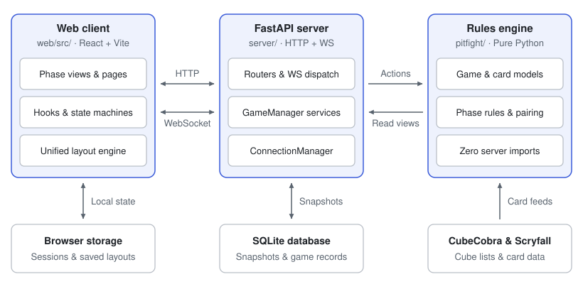

# Pitfight

Pitfight is a web app for playing
[Pitfight](https://cubecobra.com/cube/overview/auto), a Magic: The Gathering
format that mixes cube drafting with roguelike elimination fights. Players draft
from a shared pool, build hands each round, fight head-to-head or against
recorded opponents, and play until one player remains.

Join the [Discord](https://discord.gg/MKMacp9JUf) to find games, report bugs,
and talk about the format.

<picture>
  <source media="(prefers-color-scheme: dark)" srcset="docs/assets/architecture-dark.svg">
  
</picture>

- **Web client (`web/src/`)**: React, TypeScript, and Vite client with a unified
  card layout engine and state machines for lobbies, fight resolution, and
  in-game overlays.
- **Server (`server/`)**: FastAPI HTTP and WebSocket backend managing live
  games, reconnection, voice chat signaling, and SQLite snapshots.
- **Rules engine (`pitfight/`)**: Pure Python game rules and phase logic with no
  server or database imports.

## Quick start

```sh
uv sync
(cd web && npm ci)
uv run dev
```

Open `http://localhost:3000`. Vite proxies `/api` and `/ws` to the backend on
port `8000`, where `/docs` serves the OpenAPI reference. For solo games on a
fresh local database, seed synthetic opponents as shown in
[Getting started](docs/getting-started.md).

## Checks

```sh
uvx prek@0.5.11 run --all-files
uv run pytest
(cd web && npm test)
```

## Deploy labels

Merges to `develop` deploy the staging app. Merges to `main` deploy production
and create a tagged GitHub release. Pull request labels control the draining
warning window before restart and the release version bump.

| Deploy label | Staging default | Production default | Use case |
| --- | --- | --- | --- |
| *(none)* | 0 min | 15 min | Standard deploy |
| `deploy:quick` | 0 min | 0 min | Hotfixes and config changes |
| `deploy:default` | 15 min | 15 min | Explicit 15-minute warning |
| `deploy:long` | 1 hour | 1 hour | Large updates during peak hours |

| Release label | Effect on production deploy |
| --- | --- |
| *(none)* | Bump patch version |
| `release:patch` | Bump patch version (e.g. `v1.0.0` to `v1.0.1`) |
| `release:minor` | Bump minor version (e.g. `v1.0.0` to `v1.1.0`) |
| `release:major` | Bump major version (e.g. `v1.0.0` to `v2.0.0`) |

## Documentation

- [Documentation index](docs/README.md) for all guides and references
- [Getting started](docs/getting-started.md) to install, seed solo opponents,
  and play a round locally
- [Development](docs/development.md) for checks, Playwright end-to-end tests,
  load testing, container boot checks, and operations
- [Architecture](docs/architecture.md) for how the rules engine, server
  services, client hooks, and snapshots work together
- [Reference](docs/reference.md) for environment variables, CLI tools, deploy
  labels, and browser storage keys
