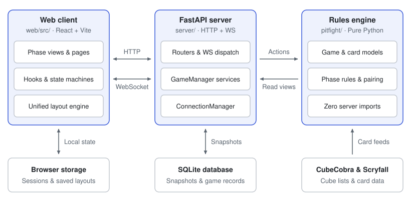

# Architecture

Pitfight runs real-time multiplayer card games where rules must stay
deterministic, active games must survive deploys, and dense card tables must fit
phones and desktops without overlapping or clipping. The system separates those
concerns into three layers with explicit ownership boundaries.

<picture>
  <source media="(prefers-color-scheme: dark)" srcset="assets/architecture-dark.svg">
  
</picture>

## Pure rules engine (`pitfight/`)

The `pitfight/` package owns the domain models (games, players, puppets, cards,
zones, and fights) and the phase transitions for Draft, Build, Fight, Reward,
and elimination. It imports nothing from `server/` or SQLite.

Keeping the rules engine independent of HTTP, WebSockets, and storage gives two
guarantees:

- Rules tests run directly against in-memory Python objects with no server
  harness.
- Active game snapshots serialize domain models directly, without dragging
  transport or session objects into persisted state.

CubeCobra and Scryfall fetchers also live in `pitfight/` so cube lists and card
metadata hydrate directly into domain card models.

## Single-owner server services and read/write separation (`server/`)

One `GameManager` instance owns every live lobby and active game on the server.
Rather than letting routes mutate shared dictionaries directly, `GameManager` is
composed in a strict dependency order over `GameManagerState`:

- `SeatService` builds on `LobbyService`, which builds on `BattlerLoader`,
  `PuppetLoader`, and `SnapshotStore`.
- `ActionHandlers` builds on `RoundService`, which builds on `SnapshotStore`.
- `SnapshotStore` builds on `SpectatorService`, which builds on
  `GameManagerState`.

Lower layers cannot call into higher ones, which prevents circular mutation
across lobby setup, round progression, and snapshot eviction.

Mutations and reads follow separate paths:

- **Writes**: Incoming WebSocket actions in `server/routers/ws.py` and
  `ws_actions.py` acquire a per-game `asyncio.Lock`, validate the player's
  phase, apply the mutation through `ActionHandlers`, and mark the game dirty
  for snapshotting.
- **Reads**: `server/services/game/view_builder.py` constructs player-scoped and
  spectator-scoped response payloads purely from model state without mutating
  `Game`, `Player`, `Puppet`, `Battle`, or manager state.
- **Transport**: `ConnectionManager` owns player and spectator sockets,
  per-connection outgoing queues, and broadcasts. It receives `GameManager` as a
  dependency to build views, rather than sharing mutable socket tables inside
  game services. Slow clients that fall behind are closed with a reconnectable
  close code (`1012`) so they fetch a fresh bootstrap on reconnect.

## React client: hooks, state machines, and unified layout (`web/src/`)

The frontend splits rendering, external synchronization, lifecycle state, and
geometry solving into distinct boundaries.

### Effect containment

Components under `web/src/components/` and `web/src/pages/` derive view state
during render and handle user input in event handlers. External side effects
(`useEffect` and `useLayoutEffect`) live inside `web/src/hooks/`, where
WebSocket subscriptions, browser storage sync, resize observers, and timers stay
isolated from presentation components.

### Explicit lifecycle state machines

Multi-step client flows that coordinate network requests, overlays, and keyboard
shortcuts use discriminated-union state machines instead of scattered boolean
flags:

- `useStartFlow` models lobby creation and auto-start as
  `idle | creating | waiting_for_start | failed`, preventing duplicate start
  calls and stale navigation.
- `useBattleEndFlow` owns the end-of-fight lifecycle
  (`idle -> submitting -> revealing -> showing_result -> transitioning -> idle`),
  locking result submission until the server responds and keeping hotkeys from
  getting stuck after cancelled or failed reveals.
- `useGameSurfaces` owns the stack of in-game overlays (Quick Guide, players
  drawer, scouting panel, zone panels, card action menu, and dialogs) so
  layering, Escape peeling, and phase teardown stay consistent across hotkeys
  and Guided Mode.

### Unified layout engine

Card tables have competing zones (hand, pool, battlefield, upgrades, sideboard)
that change size across phases and viewport ratios. `web/src/layout/` solves
card dimensions and zone frames as pure functions over measured container boxes
(`fitCards`, `computePhaseLayout`, `computeBattleZones`,
`computeConstrainedLayout`, and `redistributeSlack`).

Because card sizes are computed from the outer container box rather than from
rendered card elements, layout updates avoid measurement feedback loops. User
divider drags persist as viewport-band constraints in browser storage and clamp
safely when the window resizes.

## Snapshot persistence and deploy safety

Live games live in memory for low-latency turns, while SQLite persists recovery
state across restarts and idle eviction:

1. **Periodic and shutdown flushes**: `SnapshotStore` runs a background loop
   every `MTB_SNAPSHOT_INTERVAL_SEC` seconds to serialize dirty active games to
   `active_game_snapshots` and evict games idle longer than
   `MTB_IDLE_EVICT_MINUTES`. Graceful shutdown flushes every loaded game.
2. **Pre-restart draining**: Before a Fly deploy replaces a machine,
   `scripts/ops_mode.sh` switches the server to `draining` mode so players see a
   countdown and new games pause while active games finish or prepare to
   reconnect. The workflow restores `normal` mode even if the deploy fails or is
   cancelled.
3. **Startup maintenance and quarantine**: `scripts/start_server.sh` runs
   `scripts/maintain_db.py --apply` before booting Uvicorn. Maintenance backs up
   the database first and makes no changes if any snapshot fails to parse. When
   the server boots, it restores `active_game_snapshots` and moves any snapshot
   that still cannot deserialize into `quarantined_game_snapshots` along with
   its error, keeping startup up and preserving data for inspection.
4. **Offline-safe startup**: After the server starts accepting requests, it
   loads the default cube from CubeCobra in the background so slow or
   unreachable upstream services never block container startup.
