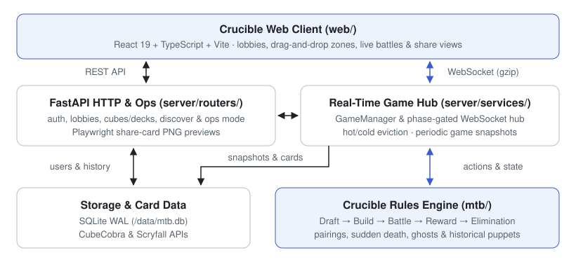

# Architecture

<picture>
  <source media="(prefers-color-scheme: dark)" srcset="../../assets/architecture-dark.svg">
  <source media="(prefers-color-scheme: light)" srcset="../../assets/architecture-light.svg">
  
</picture>

Crucible runs real-time multiplayer Magic: The Gathering autobattler pods on a single server node. A pod moves players through repeated rounds of drafting, deckbuilding, live tabletop play, rewards, and eliminations while keeping every client synchronized on sub-second card interactions and surviving server restarts.

## Design thesis and boundaries

Crucible separates game rules, live session orchestration, and browser rendering into three boundaries so each part solves a distinct problem:

- **Pure rules engine**: Card models, pack dealing, build validation, battle setup, poison calculation, eliminations, and sudden death run as pure Python state transitions with no HTTP, WebSocket, or database dependencies. Keeping game logic pure makes rules deterministic, directly testable in isolation, and cleanly serializable into snapshots and client views.
- **Authoritative real-time server**: A single FastAPI process owns live match state in memory, coordinates lobbies and authentication over REST, and drives active gameplay over WebSockets. Holding live games in memory lets rapid tabletop edits (tapping, counters, drag-and-drop card moves) broadcast immediately without waiting on disk writes, while SQLite in WAL mode provides durable persistence for accounts, completed games, and periodic active-game snapshots.
- **Thin browser client**: The React single-page app renders lobbies, drag-and-drop card zones, and live battle tables from server-pushed state views. All state mutations are sent as typed actions and validated on the server before anything changes.

External card metadata (CubeCobra lists enriched with Scryfall card data) is fetched and cached with bounded concurrency during cube warming and game start, keeping third-party HTTP calls out of the live match loop. Shareable end-of-game summary cards are rendered from persisted match records by a separate headless Chromium preview service so image generation never blocks active gameplay.

## Match flow and phase machine

A match runs in either **limited** mode (players draft from a shared Cube) or **constructed** mode (players draw packs from their own Decks). Once a pod starts, each active player cycles through a strict phase machine:

1. **Draft**: Players open packs, swap cards among pack, hand, sideboard, and upgrades, roll for new packs, and lock in their pool.
2. **Build**: Players assemble an active hand matching the current hand size, choose basic lands (`Plains`, `Island`, `Swamp`, `Mountain`, `Forest`, `Wastes`), attach upgrades or a companion, pick play/draw preference, and mark ready.
3. **Battle**: Ready participants pair off into live battles. Both players manipulate shared tabletop state (moving cards across zones, tapping, flipping, counters, attachments, tokens, library draw and shuffle, life totals, and upgrade reveals) and submit the match outcome.
4. **Reward**: Winners deal poison (`1 +` revealed applied upgrades when upgrades are enabled, or a Fibonacci progression based on hand size otherwise), players claim post-battle rewards, and survivors advance rounds and stages.
5. **Elimination and sudden death**: Once active battles settle, participants at or above the poison threshold are eliminated. If lethal eliminations would leave fewer than two survivors, the two lowest-poison lethal participants (ties broken randomly) fight in sudden death while any remaining lethal participants are eliminated immediately.

### Ghosts and historical puppets

Elimination pods frequently hit odd player counts, and smaller or solo lobbies still need full pods to play properly. Crucible handles both without forcing byes or waiting for full human tables:

- **Ghosts**: When an elimination leaves an odd number of living participants, the most recently eliminated participant is frozen as a static opponent with its final board and revealed hand so pairings stay even.
- **Historical puppets**: Completed games record round-by-round battle snapshots in SQLite. New games can fill open seats with puppet opponents backed by those historical snapshots, giving solo players and small pods realistic round-by-round opposition whose boards scale naturally across stages.

## Real-time synchronization and persistence

### Per-game serialization and phase gating

Clients send gameplay mutations over a single WebSocket per match. To prevent concurrent clicks or stale UI messages from corrupting match state, the server serializes incoming actions behind a per-game async lock and checks every action against the player's current phase before invoking the rules engine. After a mutation succeeds, the server builds tailored per-player views—preserving hidden information such as unrevealed upgrades or an opponent's unsubmitted build—and broadcasts gzip-compressed updates to players and approved spectators.

### Hot/cold game lifecycle

Because live games live in server memory on a single container, Crucible balances low latency against bounded memory and restart recovery:

- **Dirty tracking and periodic snapshots**: Mutations mark a game dirty in memory rather than flushing synchronously to SQLite. A background loop periodically writes slim active-game snapshots to SQLite in WAL mode.
- **Capacity caps and idle eviction**: The server classifies games with connected players or recent human activity as hot, caps hot games, total loaded games, pending lobbies, and WebSocket connections, and evicts idle games from memory once their snapshot is safely stored.
- **Transparent reload**: When a player reconnects to an evicted game—or when the server restarts after a deploy—the server restores the game from its latest active snapshot in SQLite.

See [Configuration and API](../reference/configuration-and-api.md) for capacity limits, snapshot intervals, HTTP route groups, and the phase-gated WebSocket action list.

## Internal vs. user-facing naming

Internal package names, environment variable prefixes, database models, and Fly app names keep their legacy identifiers (`mtb`, `battler`, `magic-the-battling`) so existing databases, URLs, and deployment configs stay backward-compatible, while user-facing copy always uses **Crucible**:

| Internal identifier | User-facing term |
| --- | --- |
| `mtb` (Python package) | Crucible |
| `battler` (API and model term) | Cube (limited) / Deck (constructed) |
| `MTB_*` (environment variables) | Crucible server config |
| `magic-the-battling` (Fly app name) | Crucible production app |
